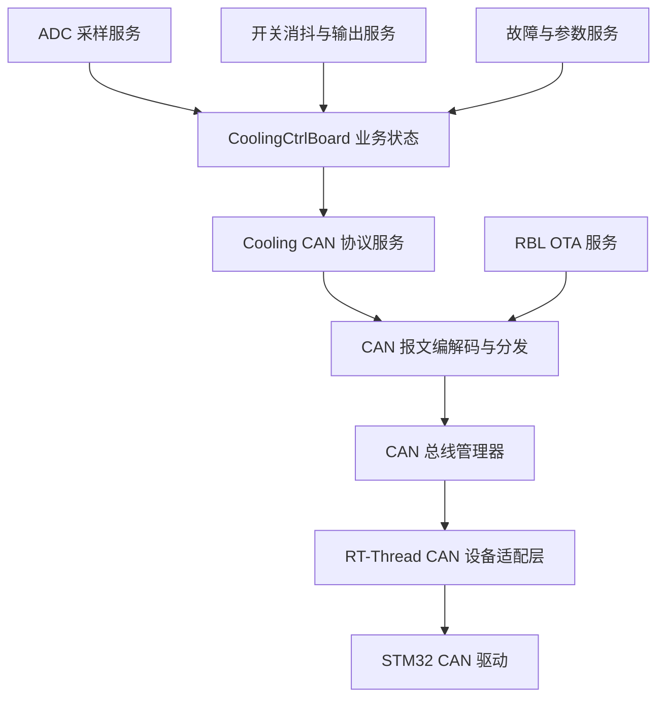

# CoolingCtrlBoard CAN 通信架构设计（草案）

## 1. 设计定位

《主控板与负极板监测_CAN通信协议-2026.06.04.xlsx》来自其他项目，本工程只借鉴其中已经验证过的组织方式，不直接复制设备地址、报文 ID 或业务含义。

可复用的设计约定：

- 业务通信优先使用 29 位扩展帧，将发起设备、接收设备、帧类别和功能号放入 ID。
- 多字节数据采用大端序，即高字节先发送。
- 状态量周期上报，状态发生变化时立即补发。
- 命令、参数写入和升级操作必须有明确回复。

不直接照搬的内容：

- 旧协议中的主控板、手具板、负极板监测板和屏幕设备编码。
- 旧协议的 `0x5000`、`0x5100` 等具体功能号。
- 旧协议的远程帧请求方式。
- 旧协议 OTA 的分包格式。CoolingCtrlBoard 已有 RBL、块 CRC16、整包 CRC32 和 Bootloader 校验流程，应保留现有校验能力。

### 1.1 当前实施状态

已经完成：

- 通用 CAN 帧定义和 RT-Thread 驱动适配层。
- `can1` 的唯一接收入口、订阅分发、互斥发送和统计接口。
- 大端序 `u16/s16/u32` 编解码函数。
- CoolingCtrlBoard 的 29 位 ID 生成/解析和应用服务入口。
- App 与 Bootloader 的 FOTA 已改为统一总线订阅者，原有 OTA ID 和数据格式未改变。

尚未冻结：

- CoolingCtrlBoard 与对端节点地址。
- ADC、IO、控制、故障和参数报文的最终功能号与字段表。
- 业务状态周期发送和控制命令处理；这些内容在节点地址和对端需求确认后接入。

## 2. 总体分层



### 2.1 板级适配层

建议文件：

- `common/can/can_port_rtthread.c`
- `common/can/can_port.h`

职责：

- 查找、配置和打开 `can1`。
- 接收中断只释放信号量，不在中断中解析业务。
- 将 RT-Thread 的 `rt_can_msg` 转换为工程内部统一帧结构。
- 隔离 RT-Thread 和 STM32 驱动细节，协议层不直接包含驱动头文件。

### 2.2 CAN 总线管理层

建议文件：

- `common/can/can_bus.c`
- `common/can/can_bus.h`

职责：

- 整个 App 只允许该层打开和读取 `can1`。
- 一个接收线程负责清空硬件接收队列，再按 ID 类型分发。
- 一个发送接口统一完成互斥、优先级和发送错误统计。
- 维护 RX/TX 计数、丢帧计数、总线关闭和恢复状态。

> 当前 `fota_can.c` 自己打开并读取 `can1`。加入业务 CAN 后必须改为由总线管理层统一接收，再把 OTA 帧投递给 FOTA；否则两个线程读取同一个设备时，可能互相取走对方的帧。

### 2.3 编解码层

建议文件：

- `common/can/can_codec.c`
- `common/can/can_codec.h`

提供固定宽度的显式函数：

- `can_get_be_u16()` / `can_put_be_u16()`
- `can_get_be_s16()` / `can_put_be_s16()`
- `can_get_be_u32()` / `can_put_be_u32()`

禁止把 C 结构体直接强制转换为 CAN 数据区，避免结构体填充、CPU 端序和编译器差异导致协议变化。

业务协议统一使用大端序。现有 OTA 若上位机已经按当前小端格式实现，则由 OTA 自己的 codec 保持兼容，不能静默改变。

### 2.4 协议定义层

建议文件：

- `applications/can/cooling_can_ids.h`
- `applications/can/cooling_can_messages.h`
- `applications/can/cooling_can_messages.c`

职责：

- 只定义设备地址、ID 组成、DLC、字段位置、缩放比例和合法范围。
- 每条报文分别提供 pack/unpack 函数。
- pack/unpack 不读取硬件，也不直接控制输出，便于在 PC 上做单元测试。

### 2.5 业务服务层

建议文件：

- `applications/can/cooling_can_service.c`
- `applications/can/cooling_can_service.h`
- `applications/can/cooling_can_config.h`

职责：

- 读取 `cooling_adc_get_snapshot()` 和 `cooling_switch_get_snapshot()`。
- 按周期生成状态帧，并在关键状态变化时立即发送。
- 校验收到的命令，再调用业务接口；协议解析函数不能直接操作 GPIO。
- 对通信超时、非法命令和重复命令执行统一策略。
- 将 OTA 标准帧路由到 FOTA 服务，但不在业务协议中处理 Flash 写入。

## 3. 29 位业务 ID 结构

借鉴参考协议的扩展帧结构：

| 位段 | 含义 | 本工程约定 |
|---|---|---|
| bit28..bit24 | 源节点 | 发送方设备地址 |
| bit23..bit19 | 目标节点 | `0x00` 为广播，其余为单播 |
| bit18..bit16 | 帧类别 | `0` 管理/普通业务，`1` 连续数据，`2` 事件/回复，`3..7` 保留 |
| bit15..bit0 | 功能号 | 由 CoolingCtrlBoard 协议表分配 |

ID 的生成公式：

```c
id = ((uint32_t)source << 24) |
     ((uint32_t)target << 19) |
     ((uint32_t)frame_class << 16) |
     function;
```

`COOLING_CAN_NODE_ID` 和对端节点 ID 必须在配置文件中设置，不能散落为魔数。当前阶段不沿用参考协议中任何现成节点号，待确认本板在整机中的角色后再冻结。

## 4. 初版功能号规划

以下是架构占位规划，不是最终对外协议：

| 功能号范围 | 用途 |
|---|---|
| `0x0000..0x00FF` | 节点信息、握手、心跳、在线状态 |
| `0x1000..0x10FF` | ADC、NTC 和传感器状态 |
| `0x1100..0x11FF` | 限位开关、加热输出和板级 IO 状态 |
| `0x2000..0x20FF` | 控制命令及命令回复 |
| `0x3000..0x30FF` | 参数读取、参数写入和保存结果 |
| `0x4000..0x40FF` | 故障置位、故障清除和诊断信息 |
| `0xF000..0xFFFF` | 维护、版本兼容和协议扩展 |

建议首批报文：

| 报文 | 方向 | 触发方式 | 主要内容 |
|---|---|---|---|
| 节点信息 | CoolingCtrlBoard → 对端 | 上电、请求 | 协议版本、软件版本、硬件版本、能力位 |
| 心跳 | CoolingCtrlBoard → 对端 | 500 ms | 运行时间、工作状态、故障摘要、滚动计数 |
| ADC 状态 | CoolingCtrlBoard → 对端 | 100 ms | `valid_mask`、序号、三路滤波值 |
| IO 状态 | CoolingCtrlBoard → 对端 | 100 ms，变化立即发送 | 原始限位、消抖限位、加热输出、变化计数 |
| 控制命令 | 对端 → CoolingCtrlBoard | 事件 | 命令、事务号、参数 |
| 控制回复 | CoolingCtrlBoard → 对端 | 每条命令 | 事务号、执行结果、实际状态、故障码 |
| 故障事件 | CoolingCtrlBoard → 对端 | 变化立即发送，周期补发 | 置位/清除、故障码、通道、附加值 |
| 参数访问 | 双向 | 请求/回复 | 参数 ID、类型、值、保存状态 |

## 5. 数据语义原则

### 5.1 ADC 与 NTC

- CAN 只读取 ADC 服务已经发布的快照，不能自行再次采 ADC。
- 首版可发送三路 `filtered` 值或毫伏值，并携带 `valid_mask`。
- NTC 温度不能直接由 ADC 数值冒充。只有确定 NTC 阻值、分压电阻、B 值或查表参数后，才能增加 `0.1 ℃` 单位的 `int16_t` 温度字段。
- 与参考协议相同，带符号温度建议使用 `int16_t`，数值 `100` 表示 `10.0 ℃`。

### 5.2 开关和输出

- 同时保留原始限位电平和消抖后的稳定电平，便于诊断。
- 控制命令只表达“请求”，实际执行前必须经过温度、限位、通信状态和故障联锁。
- 回复必须返回最终实际输出状态，不能只返回“已收到”。

### 5.3 参数

- CAN 协议只访问参数服务，不能直接写 Flash 地址。
- 参数写入先检查范围，再更新 RAM，最后由掉电保存层完成落盘。
- 回复应区分参数不存在、取值越界、忙、Flash 失败和成功。

## 6. 接收与发送流程

### 6.1 接收

1. CAN 中断通知接收线程。
2. 接收线程读出所有待处理帧。
3. 11 位标准帧先匹配现有 OTA ID；命中后交给 FOTA。
4. 29 位扩展帧解析源节点、目标节点、类别和功能号。
5. 丢弃目标不是本机/广播、DLC 不符或字段越界的帧，并增加错误计数。
6. 合法业务帧交给 `cooling_can_service`，由业务层决定是否执行。

### 6.2 发送

- 高优先级：故障、控制回复、OTA 回复。
- 中优先级：状态变化、节点信息。
- 低优先级：周期 ADC、IO 和心跳。
- 周期发送使用绝对节拍或统一调度表，避免每个报文单独创建线程。

## 7. 可靠性与安全策略

- 所有命令带事务号；收到重复事务时返回上次结果，不重复执行有副作用的动作。
- 对端心跳超时后设置通信故障，并立即关闭加热输出。
- 状态变化立即发，同时保留周期重发，避免单帧丢失造成长期状态不同步。
- CAN 硬件 CRC 负责单帧链路校验；普通周期数据不额外塞入 CRC，命令依靠事务号、回复和状态回读保证一致性。
- OTA 保留块 CRC16、整包 CRC32、RBL 校验和“校验失败不升级”的现有策略。
- 无效设备密钥时不启动 CAN 总线、业务线程或 OTA 服务，沿用当前板级授权门控。
- 使用静态队列和固定大小结构，启动完成后不依赖动态内存分配。

## 8. 与现有工程的衔接

现有模块可以直接作为数据源或执行接口：

- `cooling_adc_get_snapshot()`：提供三路原始值、滤波值、毫伏值和有效位。
- `cooling_switch_get_snapshot()`：提供原始/消抖限位和加热输出状态。
- `cooling_heater_set()`：作为输出执行接口，但上层必须先完成安全联锁。
- FOTA：保留 RBL 接收和校验逻辑，只把 `can1` 的所有权移到公共 CAN 总线管理层。

建议启动顺序：

1. 板级授权通过。
2. 初始化安全输出并保持关闭。
3. 启动 ADC、开关和参数服务。
4. 启动唯一的 CAN 总线管理器。
5. 注册业务协议处理器和 FOTA 处理器。
6. 启动周期上报调度器。

## 9. 落地阶段

1. 建立 `can_port`、`can_bus`、`can_codec` 和分发接口，不改变现有业务行为。
2. 把 FOTA 从“独占 can1”改为“注册标准帧处理器”。
3. 加入 CoolingCtrlBoard 扩展帧 pack/unpack 和 PC 侧向量测试。
4. 接入 ADC、IO、心跳和故障上报。
5. 最后接入控制命令和参数写入，并做断线关输出、重复命令和总线异常测试。

在冻结具体 CAN ID 和字段前，还需要确定两个系统级信息：CoolingCtrlBoard 在整机中的节点地址，以及它直接通信的对端节点地址。其余分层可以先按本设计实施。
